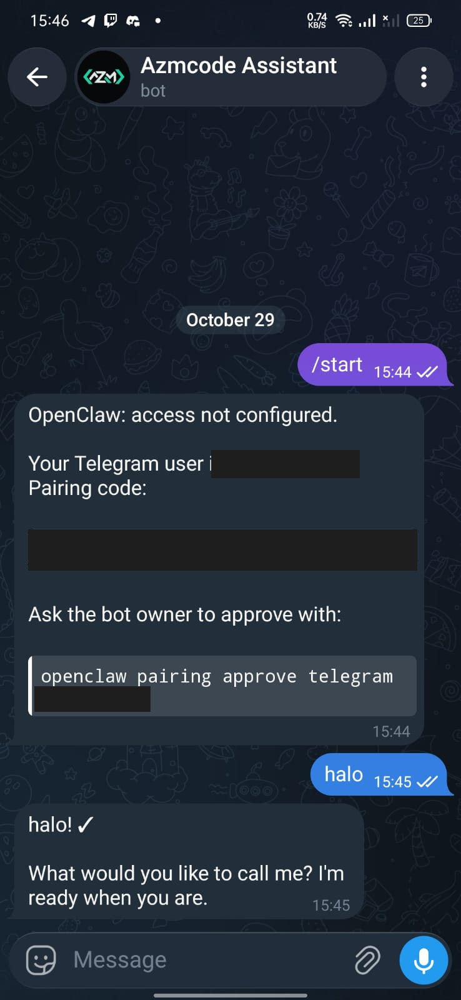
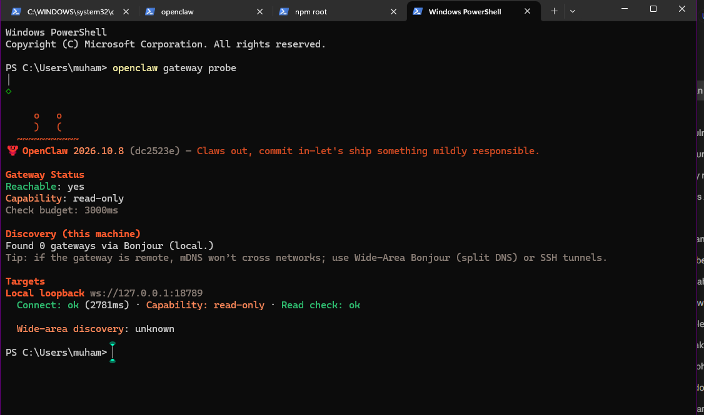

# OpenClaw Telegram Assistant

A self-hosted AI assistant built with [OpenClaw](https://openclaw.ai), running on my own Windows machine and reachable from Telegram. I set it up as a hands-on way to learn OpenClaw's gateway, channel, and pairing model, alongside my existing n8n automation work ([n8n-order-alert](https://github.com/ansrazm/n8n-order-alert)).

## What it does

- Runs an OpenClaw **gateway** locally (loopback only, `127.0.0.1:18789`).
- Connects a **Telegram bot** (created with @BotFather) to the gateway using long polling.
- Restricts access with **DM pairing**: only a Telegram account I explicitly approve can talk to the agent.
- Uses an **OpenRouter free-tier model** (`openrouter/free`) so it runs at zero cost.

```
Telegram app  <->  Telegram Bot API  <->  OpenClaw Gateway (localhost)  <->  LLM (OpenRouter free)
```

## Environment

| Item | Value |
| --- | --- |
| OpenClaw | 2026.10.8 |
| OS | Windows 11 (PowerShell) |
| Node.js | 26.x |
| Channel | Telegram (polling mode) |
| Model | `openrouter/free` (fallback from `openrouter/auto`) |

## Setup

1. **Install OpenClaw** and run the onboarding wizard (`openclaw onboard`), choosing OpenRouter as the model provider.
2. **Create the bot**: in Telegram, message @BotFather, send `/newbot`, and save the token (never commit it).
3. **Add the channel**: `openclaw configure` -> Channels -> Telegram -> paste the bot token. Keep the DM policy on **pairing**.
4. **Start the gateway** and keep it running:
   ```
   openclaw gateway
   ```
5. **Pair my account**: send `/start` to the bot. It replies with a pairing code, then approve it locally:
   ```
   openclaw pairing approve telegram <code>
   ```
6. **Verify**:
   ```
   openclaw gateway probe
   openclaw channels status
   ```
7. **Chat** from Telegram. Optional: `openclaw tui` for a terminal chat.

## Screenshots

| Telegram chat (pairing, then first reply) | Gateway reachable (`openclaw gateway probe`) |
| --- | --- |
|  |  |

## Troubleshooting notes (things I actually hit)

- **`ECONNREFUSED 127.0.0.1:18789` in `openclaw tui` / `openclaw agent`**: the gateway was not running. Start `openclaw gateway` in its own terminal and confirm with `openclaw gateway probe`.
- **Billing error, then automatic fallback**: the default model `openrouter/auto` can route to paid models. With a zero-limit API key it fails with a billing error and OpenClaw falls back to `openrouter/free`. Fix: set the default model to `openrouter/free`.
- **Control UI `token_missing` in the gateway log**: the dashboard was opened without a gateway token. Use `openclaw dashboard` to open it with the token.
- **`channels status` showed `disconnected` right after startup**: the gateway was still starting up. It reported `running` / connected once startup finished.
- **First pairing approval also set the command owner**: because `commands.ownerAllowFrom` was empty, approving my account made it the owner (can change config and restart the gateway from chat). Fine for a personal bot, but worth knowing.

## Security notes

- The bot token and API keys are **never** committed. This repo contains no secrets and no `~/.openclaw` folder.
- The gateway listens on loopback only and is not exposed through a tunnel.
- Access is pairing-only; only my own Telegram account is approved.
- Screenshots in `docs/` have the Telegram user ID, pairing code, and local network address redacted.

## Possible next steps

- Add a custom skill that triggers my n8n order-alert webhook from a Telegram message.
- Switch to a model with stronger tool-calling support for agent tasks.

## Author

Muhammad Azzam Anshori - [github.com/ansrazm](https://github.com/ansrazm)
